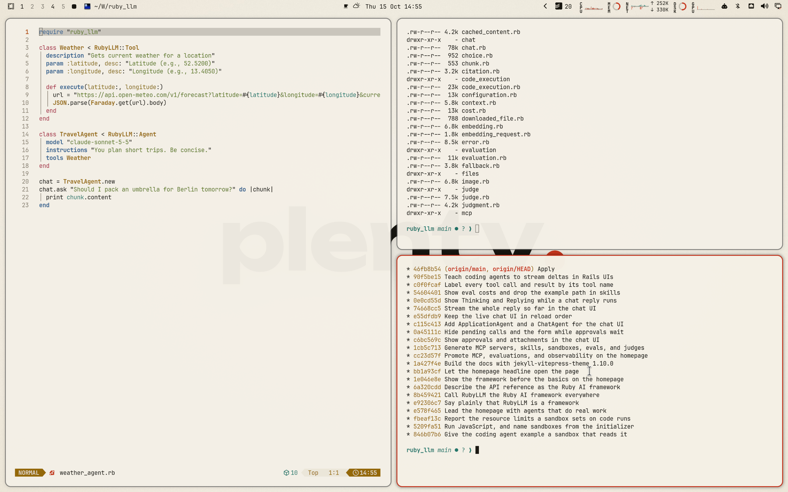

# Plenty Light for Omarchy Quattro

Paper, ink, and one vermilion full stop: a light theme sampled from the plenty.is design.



## Install

```bash
omarchy theme install https://github.com/crmne/omarchy-plenty-light-theme.git
```

Activate it with:

```bash
omarchy theme set plenty-light
```

## Architecture

This is a declarative Omarchy Quattro theme. It provides only:

- A semantic palette in `colors.toml`
- A GNOME icon theme choice in `icons.theme`
- Wallpapers in `backgrounds/`
- A selector preview in `preview.png`
- A boot unlock logo in `unlock.png`, with its selector preview in
  `preview-unlock.png`

Omarchy generates and applies the terminal, shell, Hyprland, editor, browser,
Obsidian, keyboard, and btop integrations from the semantic palette. The theme
contains no executable hooks, package installation, or application-specific
configuration files.

## Core colors

Sampled from the design tokens of [plenty.is](https://plenty.is).

- Accent: `#c7361c`
- Muted: `#857d6e`
- Background: `#f4f0e6`
- Surface: `#fbf8f1`
- Foreground: `#17150f`
- Secondary text: `#5a5448`

## Wallpapers

Original wallpapers made for this theme from the brand's own artwork:

- `01-wordmark.jpg`: The "plenty." wordmark centered on paper, soft drop shadow, faint radial light and grain
- `02-dot-grid.jpg`: The OG image's dot grid spanning the screen and fading toward the edges, one vermilion dot at the exact center
- `03-full-stop.jpg`: A single vermilion full stop resting on a hairline baseline rule across the screen

## Requirements

Omarchy 4 (Quattro) or newer.

## License

[MIT](LICENSE)
